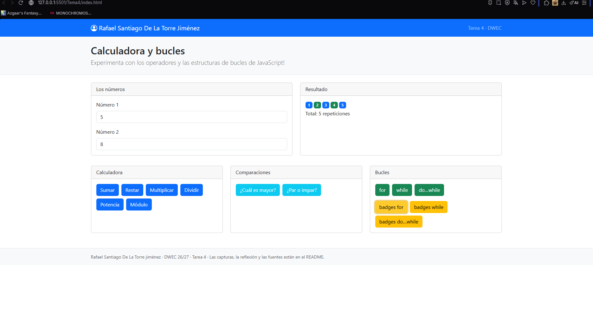
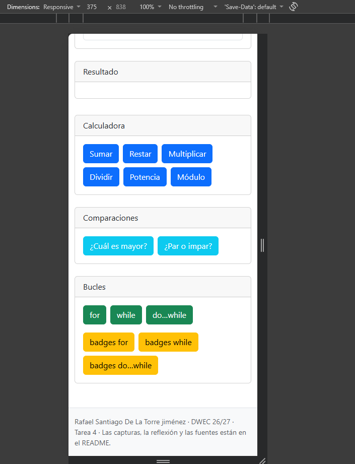
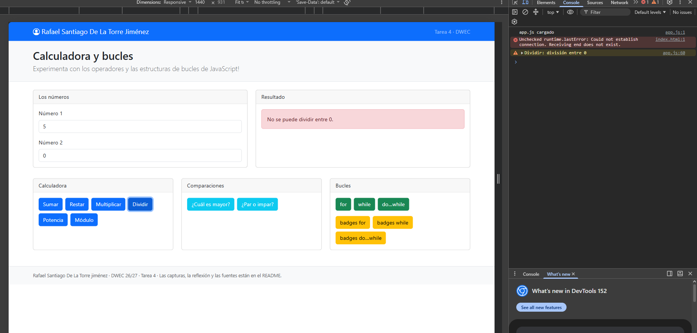
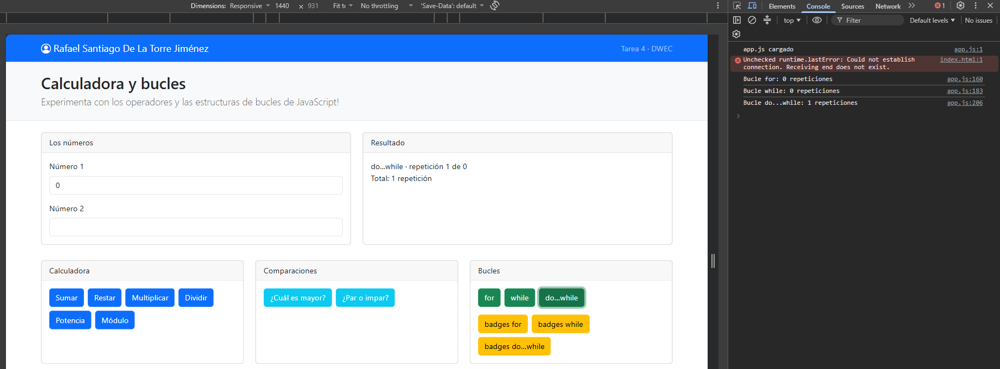
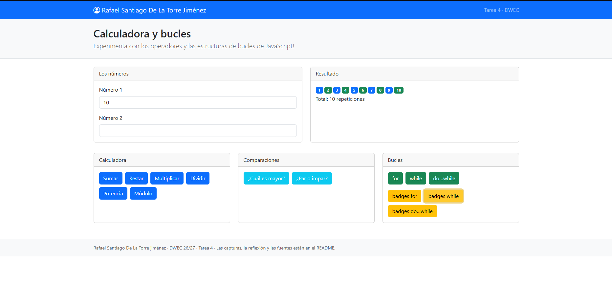

# Tarea 4 · Calculadora y bucles

**Autor:** Rafael Santiago De La Torre Jiménez · Desarrollo Web en Entorno Cliente (DWEC) · 2.º DAW · Curso 2026-27

Esta carpeta contiene la página interactiva "Calculadora y bucles". Para probarla, abre `index.html` con Live Server, introduce dos números y pulsa los botones con la consola del navegador abierta (F12).

## Capturas

### a) La página entera

Se ve mi nombre en la barra de navegación y las cards organizadas en columnas usando la rejilla de Bootstrap (`col-lg-4`), dejando la zona de números y resultado arriba.

### b) La página en el móvil

Al reducir el ancho de la pantalla, la rejilla adapta las cards a una sola columna (`col-12`) para que se apilen verticalmente y sean totalmente legibles en un dispositivo móvil.

### c) El error de dividir entre 0

La página muestra un aviso en rojo (`danger`) indicando que no se puede dividir entre 0. Simultáneamente, la consola registra el `console.warn` correspondiente para dejar rastro.

### d) Los tres bucles con el número 0

Con el valor 0, los bucles `for` y `while` no ejecutan su bloque interno. Sin embargo, el `do...while` se ejecuta exactamente una vez porque evalúa la condición al final del bloque, no al principio.

### e) Un bucle con badges

Se introduce un número (ej. 5) y se generan los badges correspondientes. El color se decide con un operador ternario: azul (`primary`) para las repeticiones impares y verde (`success`) para las pares.

## Reflexión

Primero debemos diferenciar la familia "for" de la familia "while". Aunque podemos hacerlas funcionar de la misma manera, while se ejecutará infinitamente siempre que la condición sea True, mientras que for se ejecutará un número concreto de iteraciones que definimos al iniciar. Podemos definir una variable dentro del while, que aumente en uno con cada iteración para tener el mismo funcionamiento que un for; pero para eso ya tenemos un formato más cómodo en la forma del for. La gracia del while es usar condiciones más complejas, como usar comparadores lógicos entre dos o más variables. Luego, do-while lo que hace es poner la comprobación al final de la iteración, por lo que te aseguras de el bucle ocurra al menos una vez independientemente de si se cumple la condición. Yo lo he encontrado muy útil para hacer menús, creas el menú dentro del do, y la condición para salir del bucle es que una variable sea false, la cual la vuelves false en una de las opciones del menú. Así, se ejecuta una vez el menú si o si una vez, aunque sea para elegir salir del menú.

## Fuentes

- PDF de la unidad.

## Uso de IA

He usado la IA para la maquetación de Bootstrap, dándole libertad sobre los colores de los botones y para dejar todo bien espaciado. También la he usado para el README, pasándole la plantilla y pidiendo que de las explicaciones sencillas, pero la reflexión es propia. El modelo que he usado es Qwenn3.7-Plus.