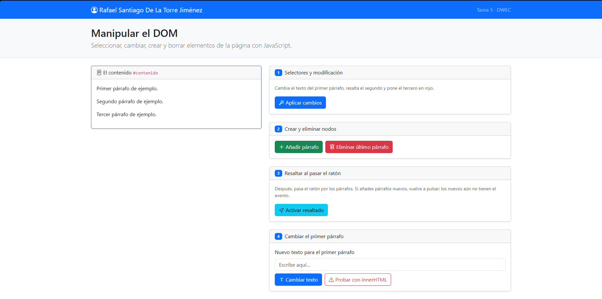
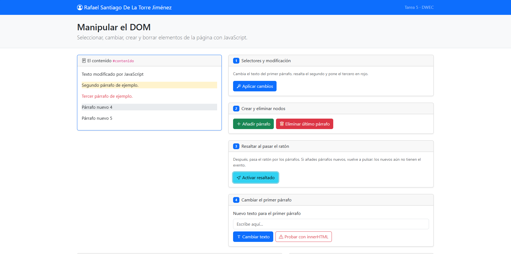
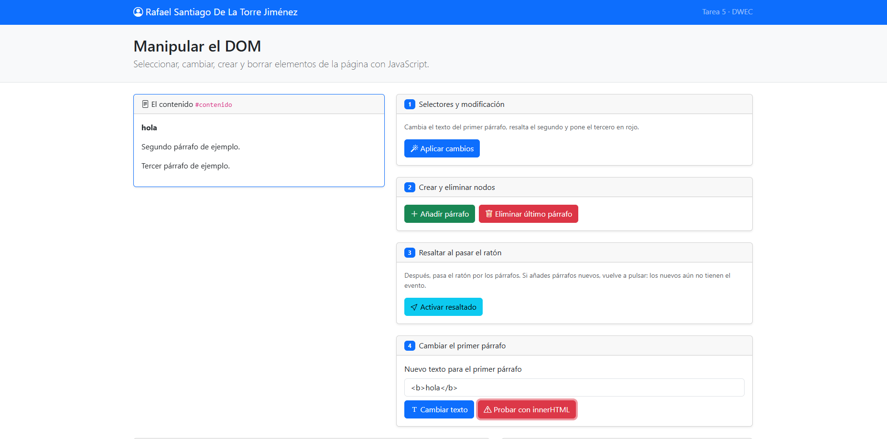
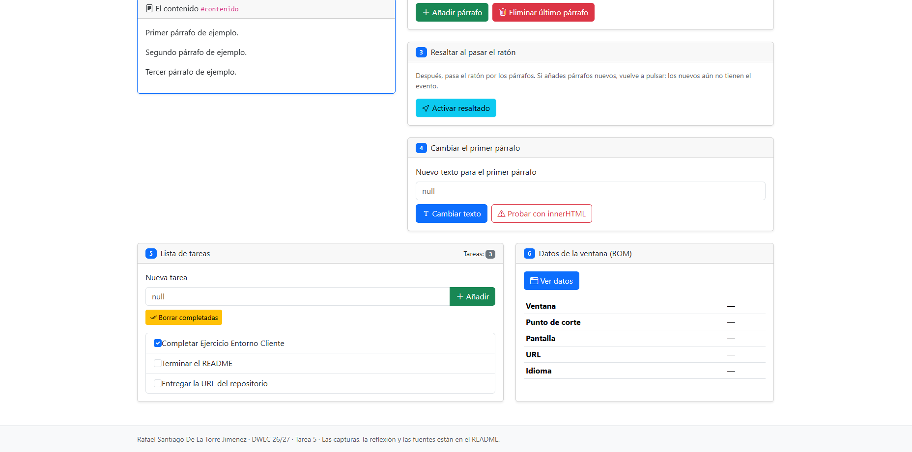
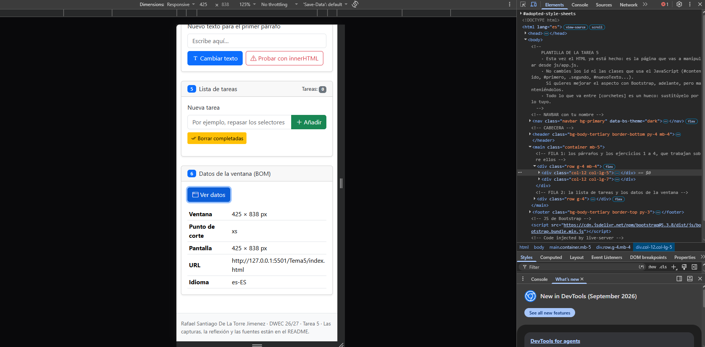

# Tarea 5 · Manipular el DOM

**Autor:** Rafael Santiago De La Torre Jiménez · Desarrollo Web en Entorno Cliente (DWEC) · 2.º DAW · Curso 2026-27

Para probar la tarea, abre `index.html` en un navegador o usa la extensión Live Server de VS Code. Abre la consola (F12) para ver los registros de cada función.

## Capturas

### a) La página recién cargada

Se ve la navbar con mi nombre y los tres párrafos iniciales dentro de la tarjeta de contenido.

### b) Ejercicios 1 y 2

El primer párrafo cambia de texto usando `getElementById`. El segundo se resalta en amarillo con `querySelector` y clase `.segundo`. El tercero se pone rojo usando `querySelectorAll` y su índice. Se han añadido dos párrafos nuevos numerados.

### c) Ejercicio 3: resaltado al pasar el ratón

Al pasar el ratón, el párrafo se vuelve gris. Los párrafos añadidos después de pulsar el botón no tienen el evento activado porque los listeners solo se asignan a los elementos existentes en ese momento.

### d) Ejercicio 4: `<b>hola</b>` con innerHTML

Con `textContent`, `<b>hola</b>` se muestra como texto plano. Con `innerHTML`, la palabra "hola" aparece en negrita porque el navegador interpreta las etiquetas HTML.

### e) Ejercicio 5: la lista de tareas

Lista con tres tareas añadidas dinámicamente. Una de ellas está marcada con el checkbox antes de usar el botón de borrar completadas.

### f) Ejercicio 6: los datos de la ventana en el móvil

En modo móvil se muestra el punto de corte correspondiente (por ejemplo, 'sm' o 'xs') y las dimensiones reducidas de la ventana.

## Reflexión

textContent interpreta todo como un String directamente, por lo que da igual si dentro se escriben numeros o algo que se podria ejecutar como codigo. innerHTML si que interpreta el contenido como codigo, por lo que si utilizamos valores introducidos por los usuarios, nos arriesgamos a que escriban scripts de codigo, que luego serian ejecutados. Esto lo hemos comprobado con <b>hola</b>, que al introducirlo con innerHTML mostraba unicamente el texto, y las etiquetas se interpretaban, cambiando el color de "hola".

## Fuentes

- [MDN Web Docs - Document.querySelector()](https://developer.mozilla.org/es/docs/Web/API/Document/querySelector)
- [MDN Web Docs - Element.classList](https://developer.mozilla.org/es/docs/Web/API/Element/classList)

## Uso de IA

He utilizado IA para eliminar los comentarios del README y las breves explicaciones. También lo he usado para algunos comentarios de código. He usado el modelo Qwen3.7-Plus.