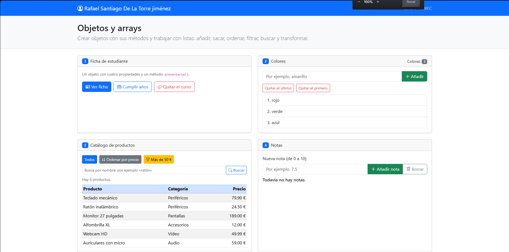
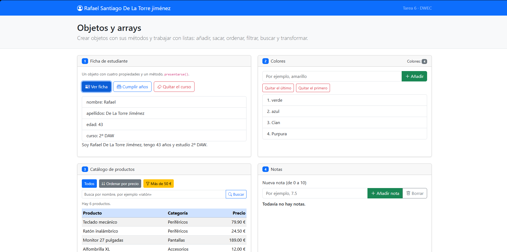
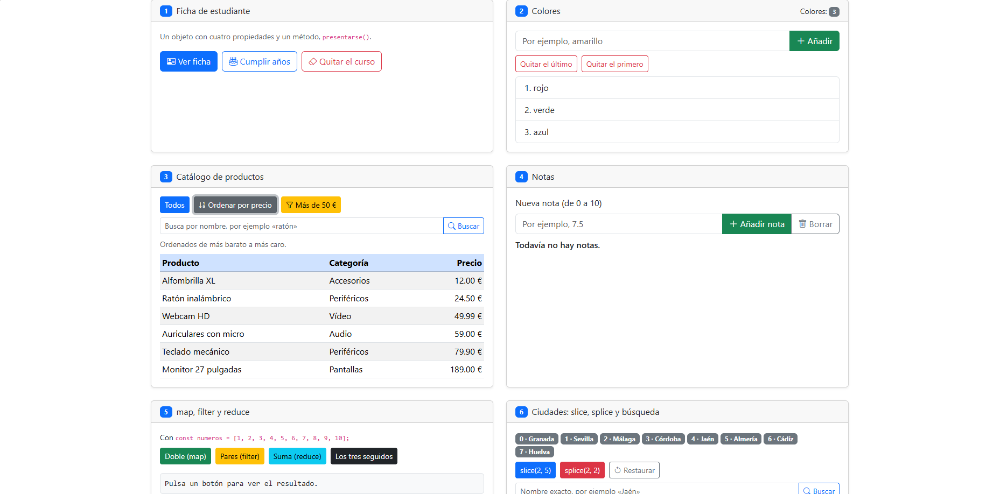
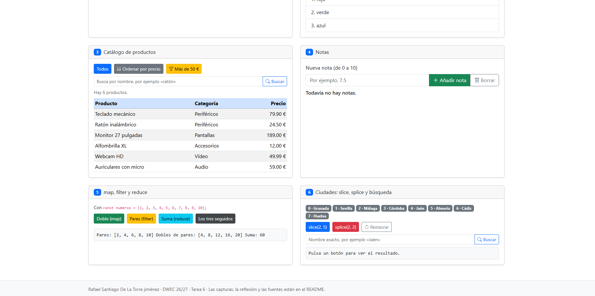
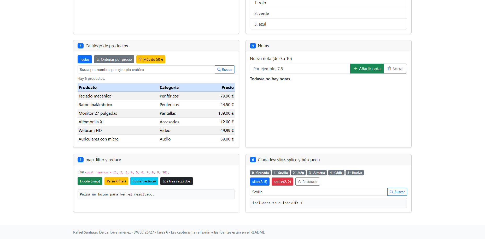

# Tarea 6 · Objetos y arrays

**Autor:** Rafael Santiago De La Torre jiménez · Desarrollo Web en Entorno Cliente (DWEC) · 2.º DAW · Curso 2026-27

> **Plantilla de la tarea 6.** Cómo usarla:
>
> 1. Copia esta carpeta en tu repositorio de DWEC y cámbiale el nombre a `tema06`.
> 2. `index.html` ya está maquetado: seis tarjetas, una por ejercicio. No cambies los `id` ni el `onclick` de los botones.
> 3. `js/app.js` trae una función por botón con `TODO`. Ya están hechas `comoTexto()`, `pintarProductos()` y casi todo el ejercicio 2: úsalas de modelo.
> 4. Todas las funciones con `function`: en esta tarea, sin funciones flecha.
> 5. Sustituye las imágenes de `capturas/` por las tuyas, **con el mismo nombre**.
> 6. Todo lo que va entre [corchetes] es un hueco: cámbialo por lo tuyo. Al terminar, borra este aviso.

Para probar la página, abre la carpeta en VS Code, lanza Live Server y usa la consola del navegador para ver los logs de cada ejercicio.

## Capturas

### a) La página recién cargada

Se ven los datos iniciales: los tres colores, la tabla de productos completa y las ocho ciudades con su índice.

### b) Ejercicios 1 y 2: la ficha y los colores

La ficha muestra la edad incrementada tras usar `cumplirAnios()`. En colores se ve la lista actualizada tras añadir elementos con `push()` y quitarlos con `pop()` o `shift()`.

### c) Ejercicio 3: el catálogo ordenado por precio

La tabla muestra los productos ordenados de menor a mayor precio usando `sort()` sobre una copia del array original para no modificar los datos base.

### d) Ejercicio 4: las notas y la media

Se muestran cinco notas con badges verdes (aprobadas) o rojas (suspensas). La media se calcula correctamente sumando todas las notas y dividiendo por la cantidad total.

### e) Ejercicio 5: los tres métodos seguidos

El proceso filtra los pares, calcula sus dobles y suma el resultado final, obteniendo 60. El array original `numeros` permanece inalterado.

### f) Ejercicio 6: después de splice y de buscar una ciudad

Tras ejecutar `splice(2, 2)`, desaparecen Málaga y Córdoba. La búsqueda indica la nueva posición de las ciudades restantes o -1 si no se encuentran. El índice de Sevilla tras el splie es 1.

## Reflexión

Los métodos como `push`, `pop`, `shift` y `splice` modifican directamente el array original, mientras que `slice`, `map`, `filter` y `find` devuelven un nuevo array sin alterar el original. En el ejercicio 6, `slice` crea una sublista temporal sin afectar a `ciudades`, pero `splice` elimina elementos permanentemente, por lo que es necesario restaurar el array. En el ejercicio 3 se ordena una copia con `[...productos]` para mantener el catálogo original intacto y poder volver a mostrarlo o filtrarlo sin perder el orden inicial.

## Fuentes

- Qwen3.7-Plus

## Uso de IA

He usado Qwen3.7-Plus para resolver dudas y para empezar los comentarios.